# 🛒 ShopSphere — E-commerce Sales Analytics

An end-to-end data analytics project exploring e-commerce sales, customers, products, deliveries, and customer reviews using **MySQL, Python, Pandas, and Power BI**.
## 🚀 Live Dashboard

🔗 **Live Streamlit Dashboard:** [View ShopSphere](https://sandeep-botche123-shopsphere-appapp-f13xtw.streamlit.app/)

### 📊 Dashboard Preview

#### Dashboard Overview
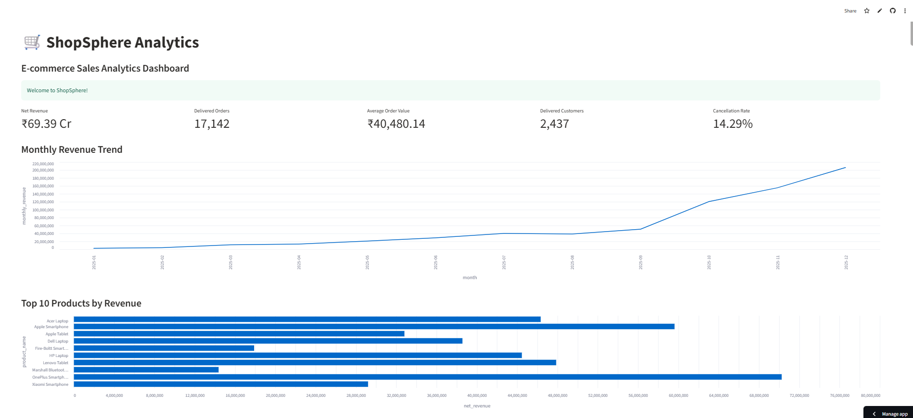

#### Customer Analytics
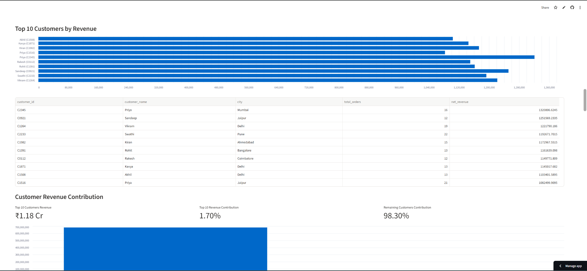

#### Product Exploration
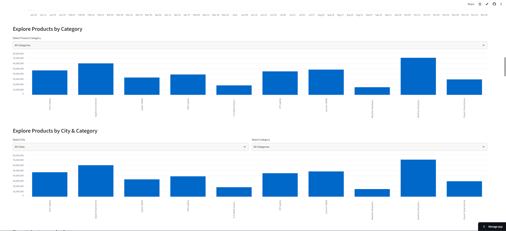
## 📊 Dashboard Preview


## 🎯 Project Overview

ShopSphere is an e-commerce analytics project built to transform raw transactional data into meaningful business insights. It combines SQL-based analysis, Python data processing, and Power BI visualizations to help understand sales performance and key business metrics.

**Project objectives:**
- Analyze revenue and monthly sales trends.
- Evaluate product and category performance.
- Understand customer purchasing behavior.
- Examine order cancellations and delivery performance.
- Explore customer ratings and product profitability.

## 🛠️ Tech Stack

- **MySQL** – Relational database design and SQL analysis
- **MySQL Workbench** – Database management and SQL query execution
- **Python** – Data processing and analysis
- **Pandas & NumPy** – Data cleaning and manipulation
- **Matplotlib** – Data visualization
- **Power BI** – KPI visualization and dashboard development
- **Streamlit** – Interactive analytics web application
- **TiDB Cloud** – Cloud-hosted MySQL-compatible database
- **SQLAlchemy & MySQL Connector** – Database connectivity
- **Git & GitHub** – Version control and project hosting
- **Streamlit Community Cloud** – Application deployment

## 📁 Dataset Overview

The project uses a synthetic e-commerce dataset with the following tables:

| Table | Records |
|---|---:|
| Customers | 2,500 |
| Categories | 5 |
| Products | 100 |
| Orders | 20,000 |
| Order Items | 49,889 |
| Payments | 20,000 |
| Deliveries | 17,142 |
| Reviews | 7,028 |

## 📈 Key Performance Indicators

| KPI | Dashboard Value |
|---|---:| 
| Net Revenue | ₹693.91M |
| Delivered Orders | 17,142 |
| Average Order Value (AOV) | ₹40,480.14 |
| Delivered Customers | 2,437 |
| Cancellation Rate | 14.29% |
| Average Delivery Time | 4.51 days |

*Values reflect the current project dashboard and dataset.*

## 🔍 Analysis Performed
This project performs end-to-end e-commerce data analysis using SQL and Python to identify business trends, customer behavior, sales performance, and product profitability.
### SQL Analysis
- Revenue and monthly sales analysis
- Category and product performance
- Customer and city-level performance
- Product profitability and ratings
- Order and delivery status analysis

### Python Analysis
- Data processing and cleaning
- Aggregation and KPI calculations
- Analysis result generation
- Exporting processed results to CSV files
## 📊 Python Data Visualizations

The following charts were created using Python, Pandas, and Matplotlib to analyze sales performance, customer segments, product profitability, and delivery operations.

### 1. Monthly Revenue Trend
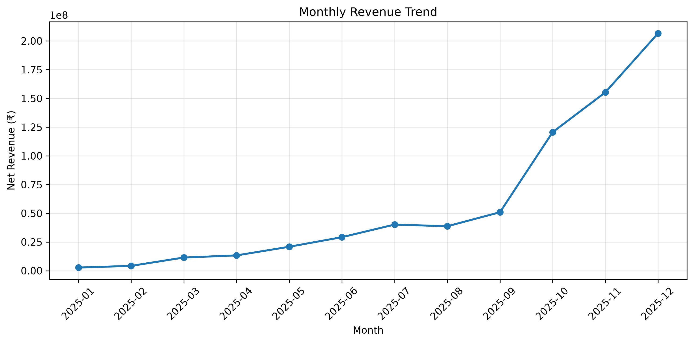

### 2. Top 10 Products by Revenue
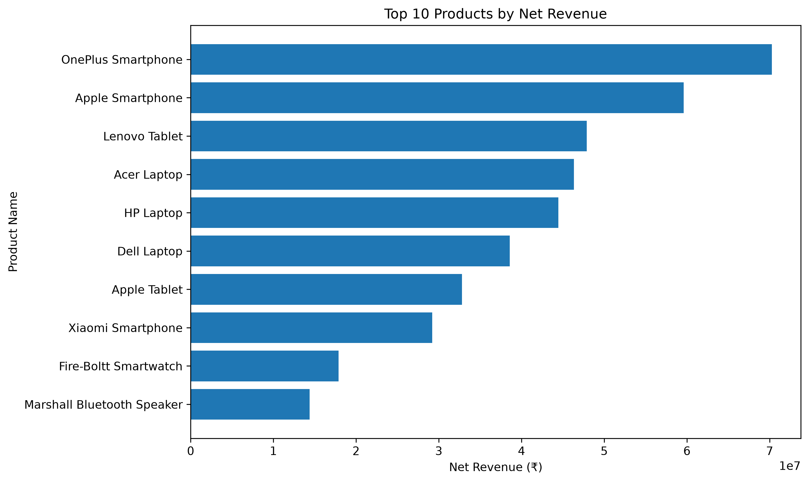

### 3. Customer Segment Revenue Contribution
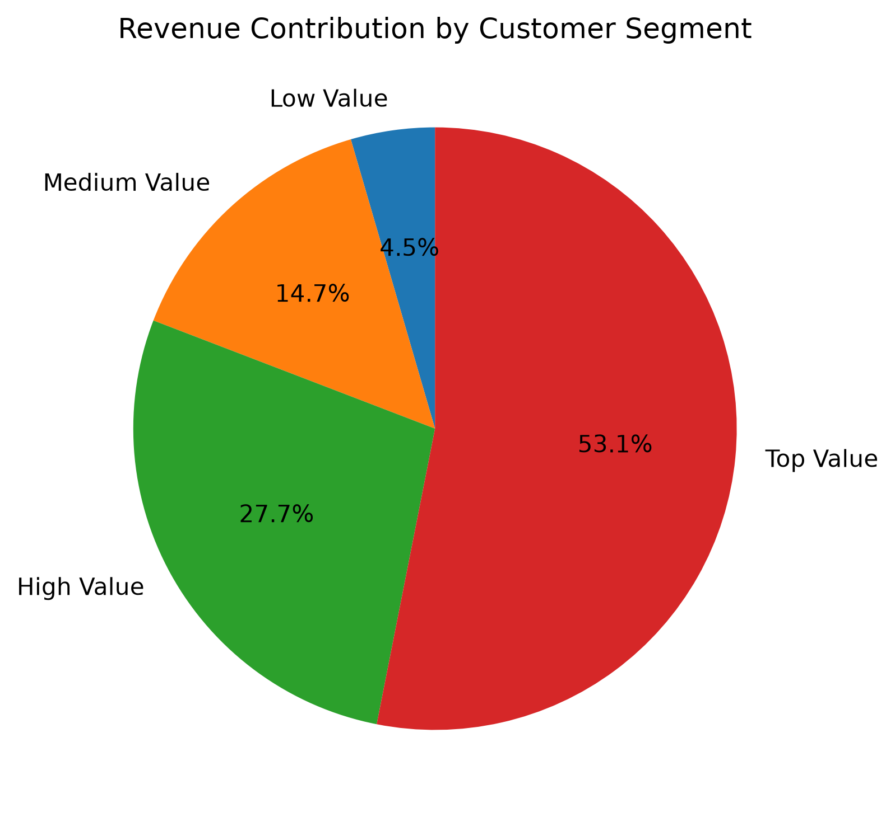

### 4. City-wise Revenue
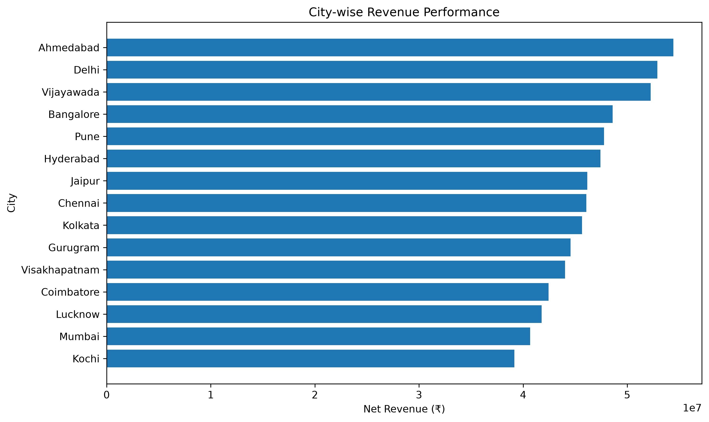

### 5. Delivery Status Distribution
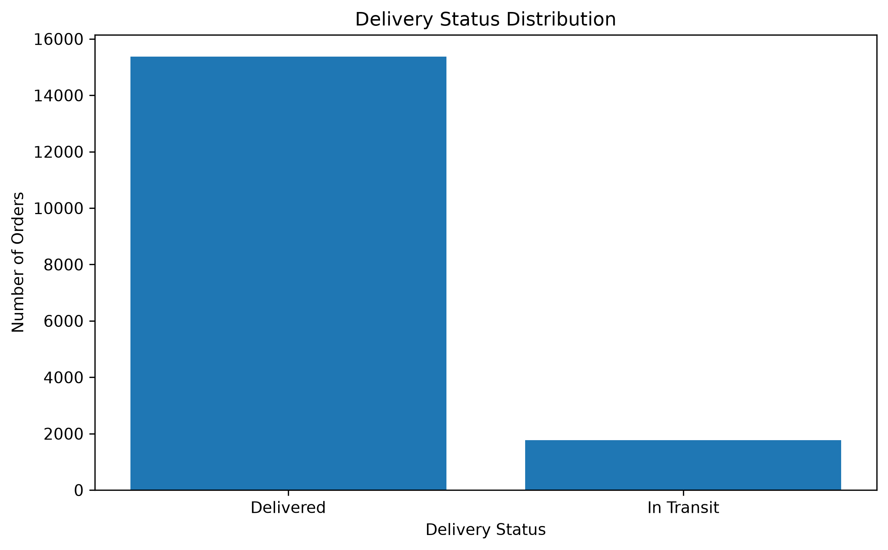

### 6. Top 10 Products by Profit
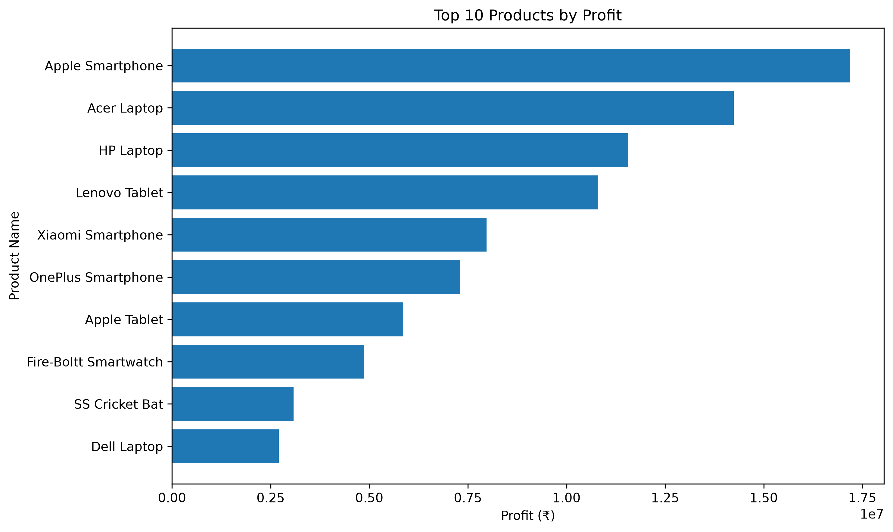

### 7. Profit by Category
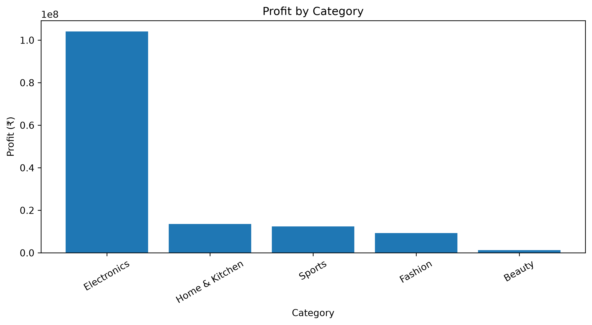

### 8. Category Revenue
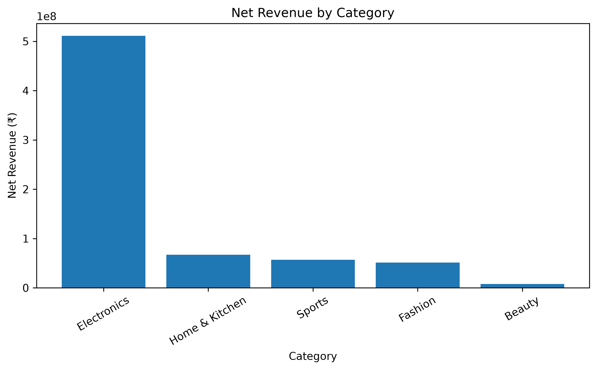

### Power BI Dashboard
- Monthly Revenue Trend
- Net Revenue
- Delivered Orders
- Average Order Value
- Delivered Customers
- Cancellation Rate
- Average Delivery Time

## 🔄 Project Workflow

1. Designed the relational database schema and created tables using MySQL.
2. Generated synthetic e-commerce data using Python.
3. Validated data consistency and loaded datasets into the database.
4. Performed business analysis using SQL queries in MySQL Workbench.
5. Cleaned, processed, and analyzed data using Python, Pandas, and NumPy.
6. Created visualizations using Matplotlib to identify trends and business insights.
7. Developed an interactive Power BI dashboard to monitor sales, profit, customers, products, and delivery performance.
8. Built a Streamlit web application for interactive data exploration and analytics.
9. Connected the application to the cloud database hosted on TiDB Cloud.
10. Deployed the Streamlit application using Streamlit Community Cloud.
11. Uploaded project code, analysis, and documentation to GitHub.

## 🗂️ Repository Structure

```text
ShopSphere/
├── DataBase/
│   ├── 01_schema.sql
│   ├── 02_insert_data.sql
│   └── 03_analysis.sql
├── data/
│   ├── raw/
│   └── processed/
├── powerbi/
│   └── ShopSphere_Dashboard.pbix
├── scripts/
│   ├── generate_data.py
│   └── validation.py
├── src/
│   ├── Database.py
│   ├── analysis.py
│   ├── data_cleaning.py
│   └── load_delivery.py
├── Dashboard (2).png
├── .gitignore
└── README.md
```

## 🚀 How to Run

### 1. Clone the repository

```bash
git clone https://github.com/sandeep-botche123/ShopSphere.git
cd ShopSphere
```

### 2. Set up Python

Create and activate a virtual environment, then install the required packages:

```bash
pip install pandas numpy matplotlib mysql-connector-python python-dotenv
```

### 3. Configure MySQL

- Ensure MySQL Server is installed and running.
- Create a local `.env` file in the project root with your own database credentials:

```text
DB_HOST=localhost
DB_USER=your_mysql_username
DB_PASSWORD=your_mysql_password
DB_NAME=shopsphere
```

- Execute the SQL scripts in the `DataBase/` folder in the appropriate order to create and populate the database.

### 4. Run the Python scripts

Use the configured Python environment to run the relevant scripts from the project root. Check each script for its execution requirements.

### 5. Open the dashboard

Open `powerbi/ShopSphere_Dashboard.pbix` using Power BI Desktop.

## 📊 Skills Demonstrated

- Relational database design and data modeling
- SQL querying, joins, aggregations, CTEs, and window functions
- Python programming for data analytics
- Data cleaning, transformation, and validation
- Exploratory Data Analysis (EDA)
- KPI calculation and business performance analysis
- Data visualization using Matplotlib
- Interactive dashboard development using Power BI
- Web application development using Streamlit
- Cloud database integration using TiDB Cloud
- Database connectivity using SQLAlchemy and MySQL Connector
- Application deployment using Streamlit Community Cloud
- Version control and project management using Git and GitHub
  
## 👨‍💻 Author
**Botche Sandeep**
Aspiring Data Analyst | Python | SQL | Power BI

[GitHub Repository](https://github.com/sandeep-botche123/ShopSphere)
